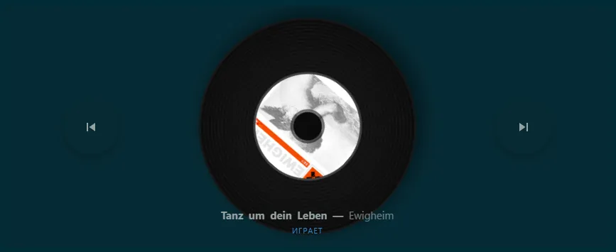

[English](#english---music-dock-card) 
# Русский - Music Dock Card

Музыкальный Док - кастомная карточка для Home Assistant с поддержкой сенсорных устройств. С помощью этой карточки можно превратить телефон в пульт управления медиаплеером.



## Возможности:
- Проигрывание музыки
- Визуализация в виде винилового диска с обложкой
- Проигрывание/пауза по тапу/клику на диск
- Переключение треков с помощью свайпов по диску
- Настраиваемые кнопки
- Слайдеры по бокам для управления громкостью или яркостью освещения

## Установка

### Через HACS/Marketplace (рекомендуется)

1. Откройте **HACS**
2. Откройте меню через три точки → **Custom repositories**
3. Добавьте пользовательский репозиторий:
   `https://github.com/hassstas/music_dock`
4. Выберите тип: **Dashboard**
5. Установите **My Lovelace Card**
6. Обновите страницу браузера

## Использование

### Базовые настройки:
```yaml
type: custom:music-dock-card
entity: sensor.temperature
```

### Кастомизация:

Базовые настройки карточки:
|Параметр|Тип|Значение по-умолчанию|Описание|
|-|-|-|-|
|`title`|string|"Музыка"|Наименование, отображается на карточке|
|`card_height`| int | 5 |Высотка карточки в строках/
|`theme_aware`|boolean| true| Использовать общую тему HomeAssistant|
|`background`| string| "linear-gradient(135deg, #1d1f24, #101215)"|CSS-цвет фона|
|`spin_duration`| int| 7| Скорость вращения пластинки, оборотов в секунду|

Настройка жестов:
|Параметр|Тип|Значение по-умолчанию|Описание|
|-|-|-|-|
|`swipe_enabled`|boolean| true|Включить поддержку свайпов для переключения треков|
|`left_slider_entity`| entity |media_player| Объект для управления левым слайдером, может быть media_player или light|
|`right_slider_entity`| entity |media_player| Объект для управления правым слайдером, может быть media_player или light|
|`show_volume_indicator`|boolean|true|Отображать индикатор слайдера

Настройка кнопок:
|Параметр|Тип|Значение по-умолчанию|Описание|
|-|-|-|-|
|`left_icon`| icon| |Иконка для левой кнопки| 
|`left_button_action`|yaml| null| yaml-код для обработки нажатия левой кнопки|
|`right_icon`| icon| |Иконка для правой кнопки| 
|`right_button_action`|yaml| null| yaml-код для обработки нажатия правой кнопки|


# English - Music Dock Card

Music Dock is a custom Home Assistant card with touch-device support. It lets you turn a phone into a media player remote control.


## Features

- Music playback
- Vinyl-disc visualization with album artwork
- Play/pause by tapping or clicking the disc
- Track switching with swipes on the disc
- Customizable buttons
- Side sliders for volume control or lighting brightness

## Installation

### Via HACS/Marketplace (recommended)

1. Open **HACS**
2. Open the menu via the three dots → **Custom repositories**
3. Add the custom repository:
   `https://github.com/hassstas/music_dock`
4. Select the type: **Dashboard**
5. Install **My Lovelace Card**
6. Refresh the browser page

## Usage

### Basic configuration:

```yaml
type: custom:music-dock-card
entity: sensor.temperature
```

### Customization:

Basic card settings:

|Parameter|Type|Default value|Description|
|-|-|-|-|
|`title`|string|"Music"|The name displayed on the card|
|`card_height`|int|5|Card height in rows|
|`theme_aware`|boolean|true|Use the global Home Assistant theme|
|`background`|string|"linear-gradient(135deg, #1d1f24, #101215)"|CSS background color|
|`spin_duration`|int|7|Record rotation speed, revolutions per second|

Gesture settings:

|Parameter|Type|Default value|Description|
|-|-|-|-|
|`swipe_enabled`|boolean|true|Enable swipe support for switching tracks|
|`left_slider_entity`|entity|media_player|Entity for controlling the left slider; can be a media_player or light|
|`right_slider_entity`|entity|media_player|Entity for controlling the right slider; can be a media_player or light|
|`show_volume_indicator`|boolean|true|Display the slider indicator|

Button settings:

|Parameter|Type|Default value|Description|
|-|-|-|-|
|`left_icon`|icon||Icon for the left button|
|`left_button_action`|yaml|null|YAML code for handling the left button press|
|`right_icon`|icon||Icon for the right button|
|`right_button_action`|yaml|null|YAML code for handling the right button press|
